<p align="center">
  
</p>

<p align="center">
  <b>A tabletop and a dungeon master for a family D&amp;D 5e campaign.</b><br>
  <i>Gemini narrates. Python decides.</i>
</p>

StoryForge is a hybrid virtual tabletop and AI dungeon master for the *Weaver's Paradox* ("The Feral World") setting. A Godot 4.6 client draws the board. Game state lives in Python (or, offline, in a GDScript port of the same logic) and is saved as local JSON snapshots. Gemini writes the narration and proposes freeform outcomes; it never owns the rules or the state.

> **Screenshots:** pending a live capture. The plate above is drawn from `data/seeds/default_campaign.json`, not from a running game.


## What this is not

- **Not standard SRD D&D.** The setting uses 35 custom species in five groups, 4 evolutionary states and 4 predator roles (4 x 4 = 560 build combinations before species choice). It borrows 5e's d20 core, not its character catalogue.
- **Not an AI that runs the game.** Every AI-proposed `StateDiff` goes through `validators.sanitize()` before `apply_diff()`. The policy is *reject, don't repair*: an illegal proposal is dropped and logged, never clamped into something legal.
- **Not standalone by default.** On desktop the default backend is `remote`: the Godot client needs the Python server running, and the server refuses to start without `STORYFORGE_GEMINI_API_KEY`. An in-process offline backend is merged (`--backend=local`) but only verified headless; see [Status](#status).
- **Not display-verified.** Nothing in this repository has been run on a screen or a phone yet. The test evidence below is headless.

## Core pillars

- **Python is the source of truth.** `core/` is pure logic with no I/O. Gemini output is a proposal and nothing more.
- **One door for mutation.** Every state change goes through `StateManager`, which serializes writes with an `asyncio.Lock` and ends in `_commit()`: revision bump, atomic snapshot, event fan-out.
- **Local-first saves.** State is a JSON snapshot on disk (`data/campaigns/<id>/state.json`), written with temp-file plus `os.replace`. No database, no account required to play.
- **Prompts are Markdown.** AI behaviour lives in `src/storyforge/ai/prompts/*.md`, not in f-strings. Edit a file, change the narrator.
- **Rules are data.** Species, states and roles are defined once in `character_factory.py`; the lobby catalog and the cards read from it.


## Contents

1. [Quickstart](#quickstart): requirements, key, launch
2. [The Species](#the-species): 35 cards in five groups
3. [How a Turn Works](#how-a-turn-works): the action pipeline
4. [The Engine](#the-engine): architecture, invariants, NPC encounters, controls, tests
5. [Status](#status): shipped, in progress, known gaps
6. [Credits](#credits)

<h2 id="quickstart"></h2>

### Requirements

- Python 3.12+ and [uv](https://github.com/astral-sh/uv)
- Godot 4.6 (the project targets 4.6; CI pins 4.6.2) on `PATH`, or `GODOT_PATH` pointing at the binary
- A Google AI Studio key, for the default `remote` backend only

### Remote mode (default on desktop)

```bash
git clone https://github.com/DaRipper91/storyforge.git
cd storyforge
uv sync
cp .env.example .env          # then set STORYFORGE_GEMINI_API_KEY in .env
uv run python main.py         # starts the server on 127.0.0.1:8765, then the Godot client
```

`main.py` launches `uvicorn storyforge.main:app` on port 8765, waits two seconds, then runs `godot --path godot`. If Godot is not found it prints an error and leaves the server running headless. To use a specific binary:

```bash
GODOT_PATH=/opt/godot/godot uv run python main.py
```

Run the halves yourself if you prefer:

```bash
uv run uvicorn storyforge.main:app --host 127.0.0.1 --port 8765   # terminal 1
godot --path godot                                                # terminal 2
curl http://127.0.0.1:8765/api/healthz                            # {"status":"ok","version":...}
```

`.env` keys (all prefixed `STORYFORGE_`, see [.env.example](.env.example)): `GEMINI_API_KEY` is required. `GOOGLE_CLIENT_ID`, `GOOGLE_CLIENT_SECRET`, `JWT_SECRET`, `ALLOWED_ORIGINS` and `CAMPAIGN_ID` are optional. The Gemini model names are constants in `src/storyforge/config.py` (`gemini-3.5-flash` primary, `gemini-3.1-pro-preview` pro), not environment variables.

### Offline mode (no server, no key)

```bash
./scripts/launch_offline.sh
# same thing: godot --path godot -- --backend=local
# or: STORYFORGE_BACKEND=local godot --path godot
```

The mode resolves in this order: `--backend=` argument, `STORYFORGE_BACKEND`, `user://backend.cfg`, then `remote` on desktop and `local` on Android. Offline play uses a GDScript `LocalBackend` and saves under Godot's `user://campaigns/`. Limits: NPC encounter routes (`/api/npc/**`) answer 503 and freeform text answers 501, because both need the AI narrator. Details: [docs/offline/](docs/offline/LOCAL_BACKEND.md).

An experimental offline Android debug APK is attached to the [apk-latest](https://github.com/DaRipper91/storyforge/releases/tag/apk-latest) release. It has not been run on a phone yet; see [docs/offline/ANDROID.md](docs/offline/ANDROID.md).

On Linux, `./update_menu.sh` writes a `.desktop` launcher that runs `launch.sh`.


<h2 id="the-species"></h2>

The Paradox rewrote the humanoid races into 35 Feral Successor species. Group membership below is read from `RACES` in [character_factory.py](src/storyforge/core/character_factory.py); the sheets are built from [godot/assets/characters/](godot/assets/characters/) by [gen_sheets.py](docs/assets/src/gen_sheets.py).

| Group | Species | Cards |
|---|---:|---|
| Cosmic | 5 | [sheet](#cosmic) |
| Primal | 5 | [sheet](#primal) |
| Eldritch | 5 | [sheet](#eldritch) |
| Mechanical | 5 | [sheet](#mechanical) |
| Humanoid | 15 | [sheet](#humanoid) |
| **Total** | **35** | |

Every character also picks one of four **evolutionary states** (Behemoth, Phantom, Swarm-Host, Mimic) and one of four **predator roles** (Stalker, Vanguard, Catalyst, Siphoner).

<h3 id="cosmic">Cosmic</h3>


<h3 id="primal">Primal</h3>


<h3 id="eldritch">Eldritch</h3>


<h3 id="mechanical">Mechanical</h3>


<h3 id="humanoid">Humanoid</h3>


The cards are the current in-repo art (800x1120 originals, downscaled and palette-reduced for the sheets). Treat them as placeholders for final art.


<h2 id="how-a-turn-works"></h2>



1. **The client posts an action.** A grid click goes to `POST /api/action/grid`; typed text goes to `POST /api/action/freeform`. Both require the `EXPLORATION` phase (otherwise HTTP 409).
2. **Grid path is deterministic.** `rules.check_grid_action()` decides legality (illegal answers HTTP 400 with a reason). `StateManager.apply_grid_action()` then mutates state. Gemini is only asked for flavor text afterwards, and the move stands if it fails.
3. **Freeform path is a proposal.** `interpreter.interpret_freeform()` returns narrative plus an optional `StateDiff`. `validators.sanitize()` returns a fresh `safe_diff` and a list of rejections. Only `safe_diff` reaches `apply_diff()`.
4. **Rejections are visible.** Each one is appended to the narrative log as `[ref] <reason>`, for example `AI tried to modify forbidden field 'hp_max' on <char_id>` or `phase change to combat is deferred to v0.2`.
5. **Everything commits the same way.** `_commit()` bumps `revision`, saves the snapshot atomically, and publishes on the event bus.
6. **The bus fans out.** Each WebSocket subscriber on `/ws/session/{room_id}` gets its own queue, and the Godot client re-renders from the pushed state.


<h2 id="the-engine"></h2>



### Invariants

1. **Python is the source of truth.** `validators.sanitize()` gates every AI-proposed `StateDiff` before `apply_diff()`. A raw Gemini response is never applied.
2. **All mutations go through `StateManager`.** One lock, one commit path.
3. **Prompts are Markdown on disk.** `src/storyforge/ai/prompts/*.md`.
4. **`core/` imports nothing from `ai/`, `api/` or `persistence/`.** No I/O in the rules.

The phase machine is `TITLE -> MENU -> MODE_SELECT -> LOBBY -> CREATION -> EXPLORATION`. `COMBAT` exists as a phase, but the validator rejects an AI-proposed change into it.

<details>
<summary>Module map</summary>

| Path | Responsibility |
|---|---|
| [core/models.py](src/storyforge/core/models.py) | Pydantic schemas; `GameState` is the root, `StateDiff` is all Gemini may touch |
| [core/state_manager.py](src/storyforge/core/state_manager.py) | In-memory state, the lock, `_commit()` |
| [core/validators.py](src/storyforge/core/validators.py) | `sanitize()`: reject, don't repair |
| [core/rules.py](src/storyforge/core/rules.py) | `check_grid_action()` legality |
| [core/character_factory.py](src/storyforge/core/character_factory.py) | `RACES`, states, roles, `build_character()` |
| [ai/](src/storyforge/ai/) | Gemini client, interpreter, narrator, prompts |
| [encounters/](src/storyforge/encounters/) | NPC services and enemy combat math |
| [persistence/snapshot.py](src/storyforge/persistence/snapshot.py) | Atomic save and load |
| [events/bus.py](src/storyforge/events/bus.py) | In-process pub/sub |
| [api/](src/storyforge/api/) | FastAPI routers and the WebSocket handler |
| [godot/](godot/) | Client; `PythonClient.gd` is the bridge, `scripts/backend/` the offline port |

</details>

### NPC encounters

Each named NPC is a pure-logic service in [src/storyforge/encounters/](src/storyforge/encounters/) with a prompt in [src/storyforge/ai/prompts/](src/storyforge/ai/prompts/). Services never touch `GameState` directly; they return a `StateDiff` for the caller to validate and apply. Encounter state lives on `app.state` and resets when the server restarts. Pets and beasts get atmosphere text only; they are never statted.

| NPC | Service | Route prefix | Prompt |
|---|---|---|---|
| Jon, the Multiversal Bodega owner | `ShopkeeperJon` | `/api/npc/jon` | `npc_jon.md` |
| Samael the Ascended | `SamaelTheDemigod` | `/api/npc/samael` | `npc_samael.md` |
| Madame Haylie | `MadameHaylie` | `/api/npc/haylie` | `npc_haylie.md` |
| Queen D.Anna | `QueenDAnna` | `/api/npc/danna` | `npc_danna.md` |
| Cinder Vale | `CinderVale` | `/api/npc/cinder` | `npc_cinder.md` |
| Guildmaster Kodrik | `GuildmasterKodrik` | `/api/npc/kodrik` | `npc_kodrik.md` |
| Bryne, Warden's apprentice | `WardenApprenticeBryne` | `/api/npc/bryne` | `npc_bryne.md` |
| Nathis, front man | `FrontManNathis` | `/api/npc/nathis` | `npc_nathis.md` |

### Controls

Bindings are registered in `PythonClient._setup_input_map()` and `Tabletop.gd`.

| Action | Keyboard / mouse | Gamepad |
|---|---|---|
| Move | WASD or arrows | Left stick |
| Interact | E or Enter | A |
| Lock on / target (hold) | Q | Left trigger |
| Freeform text bar | F | Right trigger |
| World map | M | Back |
| Reset camera | R | Start |
| Next / previous character | Tab / none | D-pad right / left |
| Select character slot | 1 to 4 | |
| Stat panel | I | |
| Orbit / zoom camera | Right-drag / mouse wheel | Right stick (look) |
| Close overlay | Esc | |

There are no touch controls yet.

### Testing

```bash
uv run pytest -q
```

At this commit that is 458 tests (character factory, validators, lobby and NPC routes, and the golden-fixture replays). The GDScript suites run headless under Godot and are not part of that command; see [tests/golden/README.md](tests/golden/README.md).


<h2 id="status"></h2>

**Shipped**

- Lobby, 35-species character creation, and exploration on the Godot tabletop client.
- The FastAPI server: 55 documented paths, WebSocket fan-out, atomic snapshots.
- Validator-gated freeform play and eight NPC encounter services.
- Offline backend merged to `main`: the core and the CORE routes ported to GDScript and replayed against recorded Python behaviour (358 function fixtures and 141 route steps, golden files in [tests/golden/](tests/golden/)). Android defaults to this backend.

**In progress**

- Touch controls for phones ([PR #270](https://github.com/DaRipper91/storyforge/pull/270), under review).
- Running the offline build on a real display and a real phone.

**Known gaps**

- Offline, `/api/npc/**` returns 503 and freeform text returns 501; both need the AI narrator.
- No touch controls: input is keyboard, mouse and gamepad. Android only has emulated mouse.
- No display-verified build of either backend. Everything above is headless evidence.
- Combat is deferred: the validator rejects AI-proposed phase changes to `COMBAT`.
- CI builds of the Android APK are signed with a throwaway key; the APK on the Releases page is signed with the project's own debug key, so only that one updates in place.
- No `LICENSE` file yet.

See [ROADMAP.md](ROADMAP.md) and [docs/](docs/README.md) for the longer history.


<a id="credits"></a>

◈ Acknowledgments ◈
​A Dedication to Deanna, 
​Every world requires an architect, and every forge needs its spark. While the mechanics of StoryForge are built on code and logic, its soul belongs entirely to my anchor, my inspiration, and my Queen, Dee. Far beyond the visuals, she breathed actual life into this realm. The rich context, the intricate backstories, and the very essence of the NPCs that populate StoryForge exist because of her creativity, her guidance, and her incredible ideas.When the logic fails and the technical walls feel insurmountable, she is the clarity that pulls me through. Without her unwavering support and brilliant perspective, these worlds would be nothing more than empty text on a screen.
​StoryForge is a shared victory, but the magic within it is hers.
​Thank you, Dee.

## 📜 Credits
- **Haley, John, & Jason**: For the constant support.
- **Brad**: For being an irreplaceable best friend, and the anvil against which my best ideas are struck.
- **Google Gemini**: The silicon voice behind the Weaver's Paradox.(What would have Been) 

<p align="center"><i>"The dice determine the fate, but the Forge shapes the story."</i></p>
