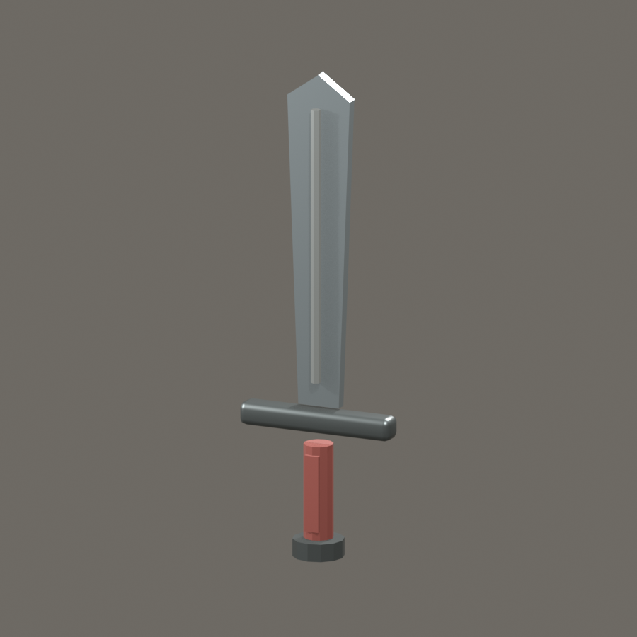
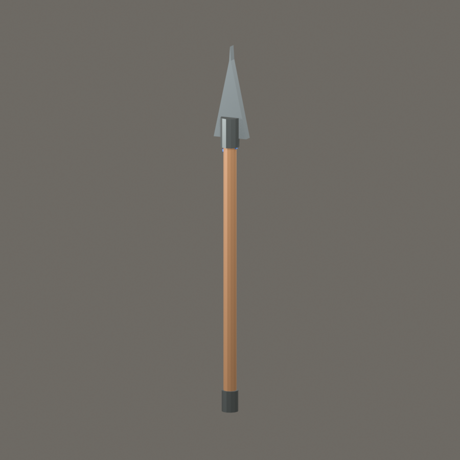
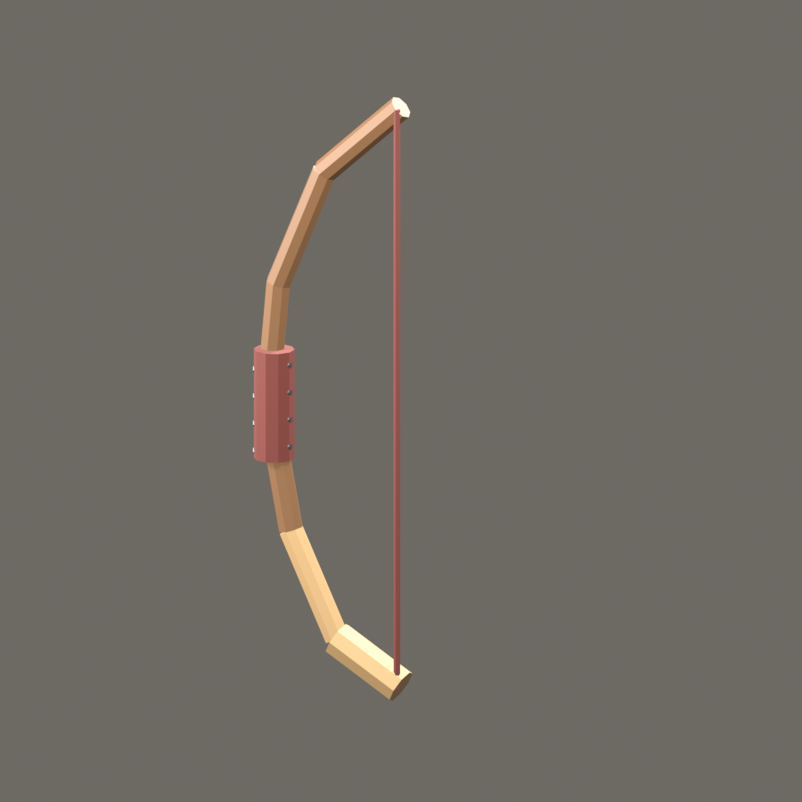
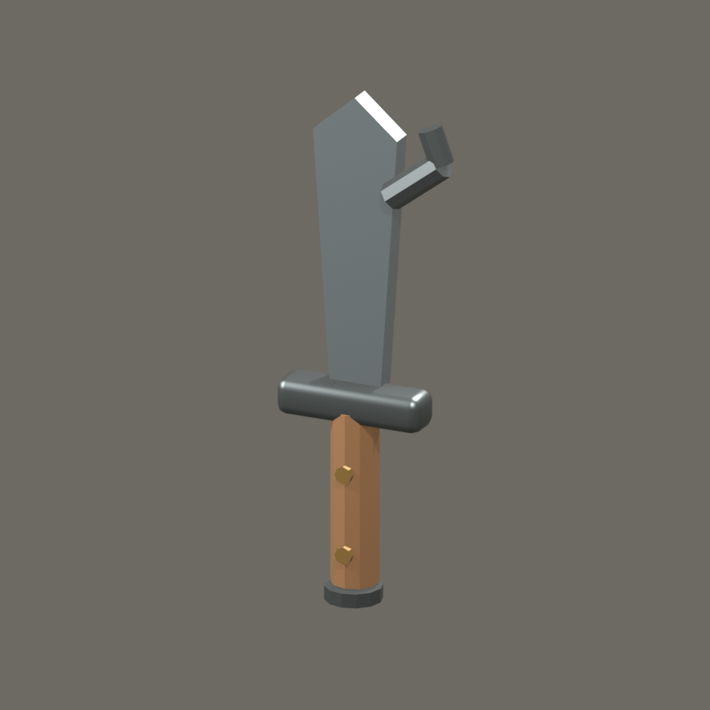
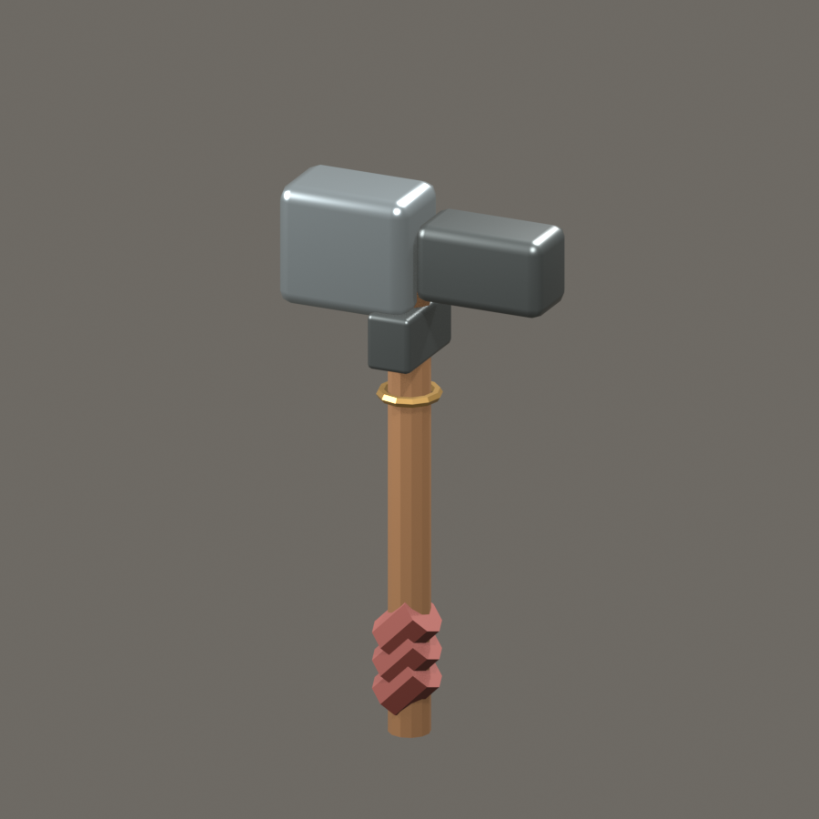

# Iron Ledge Weapon Concepts

Weapon designs for the Iron Ledge era: practical field tools with readable silhouettes, repairable construction, and a trace of the world's post-Paradox materials. These are concept-stage items; the dice and values below are proposals, not yet wired into a shop or character loadout.

## Design rules

- **Built to be carried:** Each weapon has a clear grip, balance point, and believable way to wear or stow it.
- **Iron Ledge craft:** Forged steel, ashwood, leather, brass, and recovered mechanism parts are common. Rare effects come from a specific material or maker, not unexplained glowing runes.
- **Readable at tabletop scale:** Distinct silhouette first; small engravings and inlays are secondary.
- **No free power:** A special feature has a narrow trigger and should not outshine a plain weapon on every turn.

## Proposed weapon set

| Weapon | Form | Proposed damage | Value (silver) | Role |
|---|---|---:|---:|---|
| Gateward | Arming sword | 1d8 | 180 | Reliable guard weapon |
| Wolfguard Reach | Leaf-headed spear | 1d8 | 140 | Formation control and patrol |
| Greenwood Longbow | Longbow | 1d8 | 220 | Quiet, repairable ranged weapon |
| Briarhook | Hooked woodsman's blade | 1d6 | 95 | Utility and close defense |
| Bellfound Maul | Two-handed maul | 1d10 | 200 | Heavy armor and obstacle work |

Values assume silver-denominated inventory; balance should be checked against the live economy before these become purchasable.

## Blender previews

Rendered and exported as low-poly props. The `.blend` files remain editable; the paired `.glb` files are the engine-import candidates.

| Weapon | Blender preview | Files |
|---|---|---|
| Gateward |  | [BLEND](../godot/assets/models/weapons/iron_ledge/gateward_sword.blend) · [GLB](../godot/assets/models/weapons/iron_ledge/gateward_sword.glb) |
| Wolfguard Reach |  | [BLEND](../godot/assets/models/weapons/iron_ledge/wolfguard_reach_spear.blend) · [GLB](../godot/assets/models/weapons/iron_ledge/wolfguard_reach_spear.glb) |
| Greenwood Longbow |  | [BLEND](../godot/assets/models/weapons/iron_ledge/greenwood_longbow.blend) · [GLB](../godot/assets/models/weapons/iron_ledge/greenwood_longbow.glb) |
| Briarhook |  | [BLEND](../godot/assets/models/weapons/iron_ledge/briarhook_field_knife.blend) · [GLB](../godot/assets/models/weapons/iron_ledge/briarhook_field_knife.glb) |
| Bellfound Maul |  | [BLEND](../godot/assets/models/weapons/iron_ledge/bellfound_maul.blend) · [GLB](../godot/assets/models/weapons/iron_ledge/bellfound_maul.glb) |

### Gateward — Keep issue arming sword

A hand-and-a-half blade with a broad, straight profile, shallow fuller, plain crossguard, and dark leather grip. The pommel is a flat iron disk stamped with the Iron Ledge mark. It looks maintained, not ceremonial: a sharpened edge, a few visible file marks, and a scabbard designed to survive rain and saddle wear.

- **Combat read:** dependable one-handed weapon; no special rules proposed.
- **Signature detail:** the guard is asymmetrical, with a short quillon turned toward the hand to protect it while bracing a shield.
- **Where it belongs:** standard issue for keep patrols and new company members.
- **Visual prompt:** grounded fantasy prop render, isolated three-quarter view, weathered steel and oxblood leather, neutral warm-gray studio background, believable proportions, no text or runes.

### Wolfguard Reach — Patrol spear

A long ash haft, darkened by oil and hand wear, carries a narrow leaf-shaped head with a reinforced socket. A cobalt cord is bound just below the head, echoing Bryttan's Wolfguard colors without turning the weapon into a personal relic. A small iron heel cap lets the butt plant safely on stone.

- **Combat read:** reach weapon; proposed 1d8 piercing.
- **Optional feature:** once per encounter, when an adjacent ally is charged, the wielder may spend a reaction to halt the charge on a successful contested check. No extra damage.
- **Signature detail:** blue cord and a shallow wolf-head stamp on the socket, visible only up close.
- **Where it belongs:** gate guards, road patrols, and defensive lines.
- **Visual prompt:** practical fantasy spear, straight ashwood shaft, narrow leaf blade, restrained cobalt binding, iron butt cap, studio product render, no magical glow, no text.

### Greenwood Longbow — Field bow

A laminated yew-and-ash bow built for wet woodland travel. The dark outer limb has a pale ashwood backing and simple horn nocks. Its grip is wrapped in green-brown leather; the bowstring is carried waxed in a separate pouch so it can be removed in rain.

- **Combat read:** longbow; proposed 1d8 piercing, subject to the game's ranged-weapon rules.
- **Optional feature:** no damage bonus. The well-marked draw and replaceable string reduce maintenance friction in exploration scenes.
- **Signature detail:** tiny tally cuts inside the lower limb mark repairs, not kills.
- **Where it belongs:** scouts and hunters who work the forest edge.
- **Visual prompt:** realistic fantasy longbow, laminated yew and ash, worn leather grip, horn nocks, faint repair marks, unstrung string loop beside it, neutral studio background, no arrows in flight, no text.

### Briarhook — Brush knife

A stout, forward-curved blade between a machete and a short falchion, with a clipped hook near the spine for catching vines and pulling brush aside. The hook is deliberately blunt and the inner edge remains sharpened. A wide knuckle guard and a lanyard keep it usable with gloves.

- **Combat read:** light close weapon; proposed 1d6 slashing.
- **Optional feature:** can clear a small patch of thorn or snag a loose object within arm's reach; it does not restrain a creature automatically.
- **Signature detail:** replaceable wood scales secured by two large pins, easy to repair in the field.
- **Where it belongs:** trail crews, herbalists, and scouts. It should look like a tool first.
- **Visual prompt:** close-up fantasy brush knife, forward-curved single edge, small blunt spine hook, broad practical guard, pinned hardwood scales, scuffed but cared for, no blood, neutral studio background, no text.

### Bellfound Maul — Breach and armor tool

A compact two-handed maul with a square steel face on one end and a tapered peen on the other. The head is pinned through an ash haft with a visible iron wedge. A brass ring below the head dampens rattling when carried. This is a heavy, honest tool made to break a jammed gate or a plate seam, not a jewel-encrusted executioner's prop.

- **Combat read:** heavy two-handed weapon; proposed 1d10 bludgeoning.
- **Optional feature:** on a hit against a shield or brittle barrier, it can force a stability check; no bonus damage against ordinary targets.
- **Signature detail:** faint hammer marks from repeated repair, with one small brass maker's mark under the head.
- **Where it belongs:** keep engineers and breach teams.
- **Visual prompt:** rugged fantasy two-handed maul, square steel face and tapered peen, ash haft with visible wedge and brass anti-rattle ring, repair marks, no spikes, neutral studio background, no text.

## Implementation notes

The Godot `ItemBase` currently stores weapon damage as `min_damage`, `max_damage`, and `attack_speed`; the server inventory model accepts `damage_dice`. Before implementation, pick one authoritative damage representation or define the conversion explicitly. The optional features above are design hooks only: the current item resource has no property for weapon traits. Art can use the existing weapon meshes as blockout references, then replace or customize silhouettes after the set is approved.
